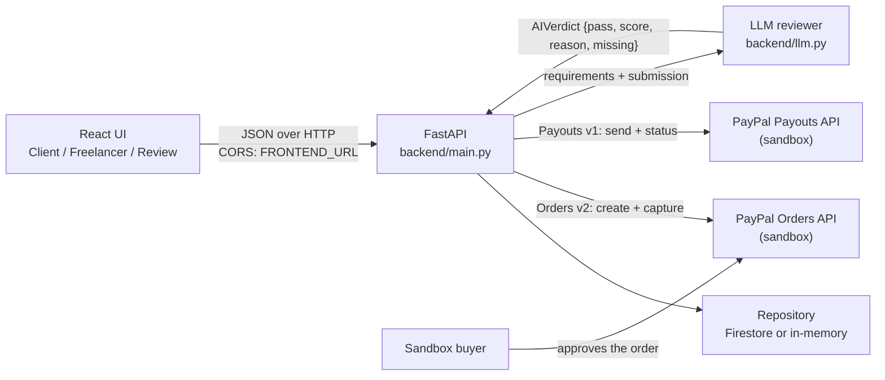
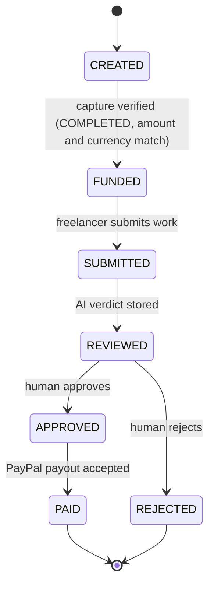

# EscrowPilot

AI-reviewed micro-task escrow on PayPal: a client funds a small task, the freelancer submits
the work, an LLM reviews it against the requirements and *advises*, and a human clicks
**Approve** — only then does the backend release the money through the PayPal Payouts API.

> **SANDBOX ONLY. No real money.** Every PayPal call targets
> `https://api-m.sandbox.paypal.com`; `PayPalClient` refuses to start against a live URL.
> All amounts are USD.

**Video:** [ADD VIDEO LINK]
**Devpost:** [ADD DEVPOST LINK]

---

## Screenshots

[ADD SCREENSHOT: Client tab — task form and a task with the "Pay $1.00 with PayPal" button]

[ADD SCREENSHOT: Review tab — requirements next to the submission, AI verdict bar, Approve/Reject]

[ADD SCREENSHOT: Confirm dialog — "You are about to pay $1.00 USD to … This cannot be undone"]

[ADD SCREENSHOT: PAID task — payout batch id, payout status, audit log]

---

## Problem

Small freelance tasks — a $5 script, a one-page summary, a data clean-up — are a trust gap.
The client does not want to pay before seeing the work; the freelancer does not want to work
before being paid. Regular escrow products are built for large contracts and heavy KYC, and
the "did they deliver?" decision still lands on a human.

## Solution

EscrowPilot escrows the money in PayPal, has an LLM judge the submission against the written
requirements, and requires a human to approve the release. The AI speeds up the review; it
never has the authority to pay.

## The guardrail: AI proposes → Human approves → PayPal confirms

1. **AI proposes.** The reviewer returns `{pass, score, reason, missing}`. It is advisory and
   is stored on the task only.
2. **Human approves.** `POST /tasks/{id}/approve` is the single code path that starts a payout,
   and it only accepts a task in `REVIEWED`.
3. **PayPal confirms.** The payout is sent with a deterministic `sender_batch_id`; the API
   reports the batch status, and the UI can refresh it.

## Architecture



The UI never talks to PayPal directly: it receives an `approve_url` from the API and sends the
buyer there. Nothing on the client can set a status, an id, or a verdict.

## State machine



`SUBMITTED` is written before the review call, so a slow or failing model never leaves a task
in a half-state. A payout failure keeps the task at `APPROVED` and surfaces PayPal's
`debug_id`, so the human can retry.

## Safety guardrails (all implemented in this repo)

| Guardrail | Where |
| --- | --- |
| **Human approval gate** — the AI verdict can never trigger a payout; only `/approve` from `REVIEWED` pays | `main.py` (`approve_task`), `state.py` |
| **Server-side state machine** — every endpoint asserts the expected state and returns 409 with both states named | `state.py` (`ALLOWED`, `transition`), `main.py` (`_require`) |
| **Funding verified against the real PayPal capture** — capture status must be `COMPLETED`, and the captured amount compares as a `Decimal` equal to the task amount in the same currency | `main.py` (`capture_task`, `_money`) |
| **Idempotent payouts** — `sender_batch_id = escrowpilot_<task_id>` is reused as the `PayPal-Request-Id`; a "batch already exists" answer is reported as 409 instead of paying twice | `paypal.py` (`send_payout`), `main.py` (`_is_duplicate_batch`) |
| **Prompt-injection-resistant review** — the submission is labelled untrusted data, wrapped in a per-call random delimiter token (`secrets.token_hex(8)`) that is stripped from the text, and a score below 70 is forced to `passed=False` server-side whatever the model claimed | `llm.py` (`SYSTEM_PROMPT`, `build_user_message`, `_defuse`, `MIN_PASS_SCORE`) |
| **Fallback verdict** — any provider/parse failure yields `{pass: false, score: 0, reason: "Automated review failed. Manual review needed."}`; `review_submission` never raises | `llm.py` (`_fallback`, `review_submission`) |
| **Amount cap and validation** — positive decimal, max two places, `MAX_TASK_AMOUNT` (default 100.00 USD), real email for the payee | `models.py` (`TaskCreate`) |
| **Audit log** — append-only per-task entries, including `CAPTURE_REJECTED`, `PAYOUT_FAILED`, `PAYOUT_DUPLICATE` | `models.py` (`AuditEntry`), every endpoint |
| **Sandbox-only enforcement** — the client raises `PayPalConfigError` unless `PAYPAL_BASE_URL` contains "sandbox" | `paypal.py` |
| **Secrets stay in `.env`** — responses expose PayPal's `{message, debug_id}` only; no credential or raw upstream body is ever returned or logged | `main.py`, `paypal.py` |

## Tech stack

- **Backend:** Python 3.11+, FastAPI, Pydantic v2, Uvicorn, httpx, `python-dotenv`
- **Storage:** Google Cloud Firestore via `firebase-admin` when `FIREBASE_CREDENTIALS_PATH`
  exists, otherwise an in-memory repository (deep copies, newest-first listing)
- **Reviewer:** Anthropic SDK or Gemini REST (`LLM_PROVIDER=anthropic|gemini`)
- **Frontend:** React 18 + Vite 5, plain JavaScript and one CSS file (no UI, router or state library)
- **Tests:** pytest + FastAPI `TestClient`, no network

**PayPal APIs used:** Orders v2 (`POST /v2/checkout/orders`, `POST /v2/checkout/orders/{id}/capture`)
and Payouts v1 (`POST /v1/payments/payouts`, `GET /v1/payments/payouts/{batch_id}`), plus
`POST /v1/oauth2/token` for the cached client-credentials token.

## Setup

### Prerequisites

- Windows PowerShell, Python 3.11+, Node.js 18+ (tested on Node 24)
- A PayPal **developer** account (any normal PayPal account can log in at
  <https://developer.paypal.com/dashboard/>)

### PayPal sandbox accounts

1. **Developer Dashboard → Testing Tools → Sandbox Accounts.** You need three personas:
   - a **Business** account that owns the API app and sends the payout
     (the default `sb-…@business.example.com` works),
   - a **Personal** account as the **buyer** who funds the task,
   - a **Personal** account as the **freelancer** who receives the payout.
     Create it with **+ Create account** (type *Personal*, country *United States*, currency *USD*).
   - Read each account's email and password under **View/Edit account**. Log in with those
     at <https://www.sandbox.paypal.com> — your real PayPal login does not work there.
2. **Apps & Credentials → Sandbox → Create App** (`EscrowPilot Sandbox`). Copy the **Client ID**
   and **Secret**. The app belongs to the Business account, so that account sends the payout.
3. The Business account needs spendable USD for the payout. Sandbox fees are deducted from the
   captured amount, so paying out the exact captured amount can return `INSUFFICIENT_FUNDS`.

### Environment

```powershell
cd C:\paypal
Copy-Item .env.example .env
```

Fill in `.env` (values are never committed; only names are listed here):

| Variable | Purpose |
| --- | --- |
| `PAYPAL_CLIENT_ID` | Sandbox app client id |
| `PAYPAL_CLIENT_SECRET` | Sandbox app secret |
| `PAYPAL_BASE_URL` | Must contain `sandbox` (default `https://api-m.sandbox.paypal.com`) |
| `PAYPAL_SANDBOX_RECEIVER_EMAIL` | Optional default payee for the smoke script |
| `FIREBASE_CREDENTIALS_PATH` | Optional Firestore service-account key; unset → in-memory store |
| `FIREBASE_PROJECT_ID` | Optional Firestore project id |
| `LLM_PROVIDER` | `anthropic` or `gemini` |
| `LLM_API_KEY` | Provider key; without it every review falls back to manual review |
| `LLM_MODEL` | Model id (no built-in default on purpose) |
| `FRONTEND_URL` | Where PayPal returns the buyer; the only CORS origin (default `http://localhost:5173`) |
| `MAX_TASK_AMOUNT` | Server-side per-task cap in USD (default `100.00`) |

Frontend: `frontend/.env` with `VITE_API_URL=http://localhost:8000`.

### Run the backend

```powershell
cd C:\paypal
python -m venv .venv
.\.venv\Scripts\Activate.ps1
pip install -r requirements.txt

cd backend
..\.venv\Scripts\python.exe -m uvicorn main:app --port 8000
```

`GET http://localhost:8000/health` → `{"status":"ok"}`; interactive docs at
<http://localhost:8000/docs>.

### Run the frontend

```powershell
cd C:\paypal\frontend
npm install
Copy-Item .env.example .env -Force
npm run dev
```

<http://localhost:5173> must be the `FRONTEND_URL` the backend allows through CORS.

## Tests

```powershell
cd C:\paypal\backend
..\.venv\Scripts\python.exe -m pytest tests -q
```

Current result on this machine: **`117 passed`**. The suite uses `TestClient`, a fake PayPal
client and a scripted reviewer, so it needs no network, no API key and no PayPal account.

Coverage: models and amount validation, the state machine, the reviewer (prompt building,
telling-out-of-delimiter, score forcing, fallback), and every endpoint including 404 / 409 /
422 / 502 mapping, CORS, the human-approval gate and payout idempotency.

### Live scripts

```powershell
cd C:\paypal
# 1. Validate PayPal config with no network calls (secrets masked)
.\.venv\Scripts\python.exe scripts/paypal_smoke_test.py --check-config

# 2. Full money path: token -> order -> approve in browser -> capture -> payout
.\.venv\Scripts\python.exe scripts/paypal_smoke_test.py --amount 1.00

# 3. Same, without the Payouts call
.\.venv\Scripts\python.exe scripts/paypal_smoke_test.py --amount 1.00 --skip-payout

# 4. Three sample submissions through the real LLM (needs LLM_* in .env)
.\.venv\Scripts\python.exe scripts/review_samples.py
```

### Manual API walkthrough

`backend/API_WALKTHROUGH.md` is a step-by-step PowerShell run of one $1.00 sandbox task,
with the expected JSON at every step.

## API reference

All money-moving endpoints answer `409` on a wrong state, `404` for an unknown task, `422` for
an invalid body, and `502` with `{message, debug_id}` when PayPal fails.

| Method | Path | Requires | Purpose |
| --- | --- | --- | --- |
| `GET` | `/health` | — | Liveness probe |
| `POST` | `/tasks` | — | Create the task and its PayPal order; returns `approve_url` (201) |
| `GET` | `/tasks` | — | List tasks, newest first |
| `GET` | `/tasks/{id}` | — | One task with its audit log |
| `POST` | `/tasks/{id}/capture` | `CREATED` | Capture the approved order and verify status, amount and currency → `FUNDED` |
| `POST` | `/tasks/{id}/submit` | `FUNDED` | Store the submission, run the review → `SUBMITTED` then `REVIEWED` |
| `POST` | `/tasks/{id}/approve` | `REVIEWED` | Human approval; the only path that sends a payout → `APPROVED` → `PAID` |
| `POST` | `/tasks/{id}/reject` | `REVIEWED` | Human rejection, no payout → `REJECTED` |
| `POST` | `/tasks/{id}/retry-payout` | `APPROVED` | Retry a failed payout; duplicate batches are refused |
| `GET` | `/tasks/{id}/payout-status` | payout batch exists | Read the batch status from PayPal without changing the task |

## Demo flow

1. **Client** creates a $1.00 task with requirements for a small code/text deliverable. The API
   creates a PayPal CAPTURE order and returns `approve_url`.
2. The client clicks **Pay $1.00 with PayPal**, logs in as the sandbox **buyer** and pays.
3. PayPal redirects to `/return?task_id=…`; the UI captures and verifies the payment, and the
   task becomes **FUNDED**. Refreshing that page does not capture twice.
4. **Freelancer** opens the task, pastes the work and submits. The backend stores it, asks the
   model for a verdict, and moves the task to **REVIEWED**.
5. **Review** shows requirements beside the submission, the score bar, the reason and any
   missing items.
6. A human clicks **Approve and pay** and confirms the dialog ("You are about to pay $1.00 USD
   to <email>. This cannot be undone."). The payout is sent, the task becomes **PAID**, and the
   batch status can be refreshed.
7. The audit log shows the whole chain:
   `TASK_CREATED → FUNDED → SUBMISSION_RECEIVED → REVIEW_COMPLETED → APPROVED → PAID`.

## Known limitations

- **Sandbox only.** Live PayPal URLs are rejected by design.
- **USD only** (`currency` is a `Literal["USD"]`).
- **Refunds are not automated.** Rejecting a task records `REJECTED` and does not return the
  captured money; a refund would be a manual PayPal action.
- **Default storage is in-memory**, so tasks disappear when the backend restarts unless
  Firestore is configured.
- **No authentication.** The three role tabs are a demo device, not access control; any client
  can call any endpoint. A real deployment needs per-user auth and ownership checks.
- **Review is text/code only.** There is no file upload, no test execution and no screenshot
  inspection; the reviewer judges the submitted text against the written requirements.
- **Payouts can stay `PENDING` or `UNCLAIMED`** in the sandbox; `UNCLAIMED` means the receiver
  email has no sandbox PayPal account. This is sandbox behaviour, not an app bug.
- **Without `LLM_API_KEY`** every review returns the fallback verdict ("Manual review needed").
- **The reviewer is advisory and fallible** — a wrong PASS is still a human decision away from
  paying, which is exactly what the approval gate is for.

## Future work

- Per-user accounts with ownership checks on every endpoint
- Automated refunds on `REJECTED`
- Milestones and partial releases for larger tasks
- Structured deliverables (file uploads, test-run evidence) instead of pasted text
- Webhooks instead of polling for payout completion

## Repository layout

```
escrowpilot/
  backend/
    main.py                FastAPI app: endpoints, guards, error mapping
    models.py              Task, TaskCreate, AIVerdict, Status, audit entries
    state.py               Allowed transitions, InvalidTransition
    db.py                  Repository protocol, in-memory and Firestore stores
    paypal.py              Sandbox PayPal client (orders, capture, payouts)
    llm.py                 Provider-agnostic reviewer with injection hardening
    API_WALKTHROUGH.md     PowerShell walkthrough of one $1.00 task
    tests/                 117 pytest tests
  frontend/
    src/App.jsx            Routes, role tabs, Client / Freelancer / Review views
    src/api.js             Fetch wrapper for all endpoints
    src/components/        TaskForm, TaskList, TaskCard, ReviewPanel,
                           VerdictBar, AuditTimeline, StatusBadge, Toast
    src/styles.css         Single stylesheet
  scripts/
    paypal_smoke_test.py   Standalone token -> order -> capture -> payout check
    review_samples.py      Three sample reviews through the real LLM
  DEMO.md                  3-minute video script
  DEVPOST.md               Submission text
  SUBMISSION_CHECKLIST.md  Pre-submission checklist
```

## License

MIT — see [LICENSE](LICENSE).
